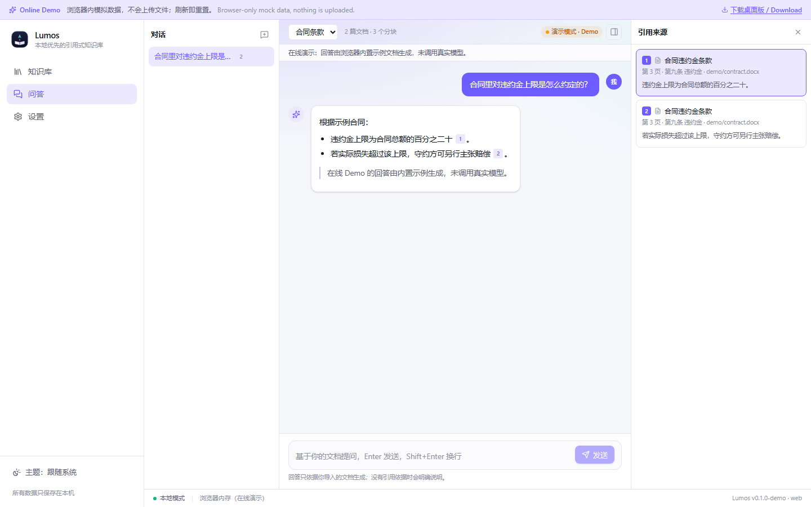
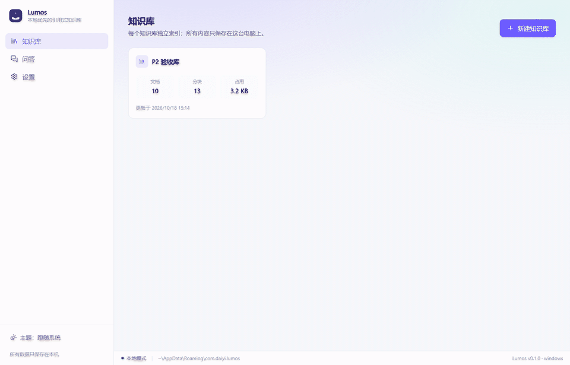
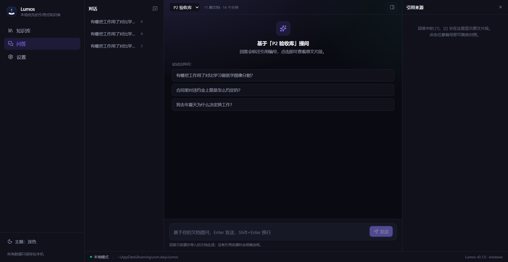

# Lumos

**本地优先的个人知识库：把文档喂进去，用 AI 提问，每个回答都标注可点击的引用。**

[English](README.md) · [简体中文](README.zh-CN.md) · [繁體中文](README.zh-TW.md) · [日本語](README.ja.md)

[](https://github.com/DaiYiqq/lumos/actions/workflows/ci.yml)
[](https://github.com/DaiYiqq/lumos/releases/latest)
[](https://github.com/DaiYiqq/lumos/releases)
[](LICENSE)
[](CONTRIBUTING.md)
[](https://daiyiqq.github.io/lumos/)

Lumos 会导入 PDF、EPUB、Word、Markdown、网页、纯文本与代码文件，在**本机**完成解析、分块、
向量化与检索，并**只依据你的文档**回答问题。每个结论都带 `[n]` 引用编号，点一下即可回到原文的
具体段落、页码与章节。文档、向量与对话全部保存在本机的一个 SQLite 数据库里。

> ▶ **在线 Demo：** <https://daiyiqq.github.io/lumos/>
>
> Demo 完全在浏览器内运行，内置少量示例文档与模拟后端；不会上传文件，也不需要 API Key。
> 真实文档、本地模型、文件监听与 AI Provider 请下载桌面版体验。



## 下载

安装包发布在 **GitHub Releases**，下载无需注册或登录。按操作系统与架构选择：

| 平台        | 架构                   | 安装包                | 直接下载                                                                                                             |
| ----------- | ---------------------- | --------------------- | -------------------------------------------------------------------------------------------------------------------- |
| **Windows** | x64                    | NSIS `.exe`（推荐）   | [Lumos_0.1.0_x64-setup.exe](https://github.com/DaiYiqq/lumos/releases/download/v0.1.0/Lumos_0.1.0_x64-setup.exe)     |
| **Windows** | x64                    | MSI                   | [Lumos_0.1.0_x64_en-US.msi](https://github.com/DaiYiqq/lumos/releases/download/v0.1.0/Lumos_0.1.0_x64_en-US.msi)     |
| **Windows** | arm64                  | NSIS `.exe`           | [Lumos_0.1.0_arm64-setup.exe](https://github.com/DaiYiqq/lumos/releases/download/v0.1.0/Lumos_0.1.0_arm64-setup.exe) |
| **Windows** | arm64                  | MSI                   | [Lumos_0.1.0_arm64_en-US.msi](https://github.com/DaiYiqq/lumos/releases/download/v0.1.0/Lumos_0.1.0_arm64_en-US.msi) |
| **macOS**   | Apple Silicon（M1–M4） | `.dmg`                | [Lumos_0.1.0_aarch64.dmg](https://github.com/DaiYiqq/lumos/releases/download/v0.1.0/Lumos_0.1.0_aarch64.dmg)         |
| **Linux**   | x64                    | `.AppImage`（免安装） | [Lumos_0.1.0_amd64.AppImage](https://github.com/DaiYiqq/lumos/releases/download/v0.1.0/Lumos_0.1.0_amd64.AppImage)   |
| **Linux**   | x64（Debian/Ubuntu）   | `.deb`                | [Lumos_0.1.0_amd64.deb](https://github.com/DaiYiqq/lumos/releases/download/v0.1.0/Lumos_0.1.0_amd64.deb)             |
| **Linux**   | x64（Fedora/RHEL）     | `.rpm`                | [Lumos-0.1.0-1.x86_64.rpm](https://github.com/DaiYiqq/lumos/releases/download/v0.1.0/Lumos-0.1.0-1.x86_64.rpm)       |

→ **全部版本：** <https://github.com/DaiYiqq/lumos/releases/latest>

> 当前安装包**未签名**，Windows SmartScreen 与 macOS Gatekeeper 首次运行时可能提示未知发布者，
> 下面给出安全的处理步骤。
>
> **暂不支持 macOS Intel**：本地嵌入模型依赖的 ONNX Runtime 预编译产物没有 x86_64 macOS 版本。

## 安装

### Windows（x64 / arm64）

1. 普通电脑下载 `Lumos_0.1.0_x64-setup.exe`；ARM 电脑（骁龙等）下载
   `Lumos_0.1.0_arm64-setup.exe`。习惯 MSI 也可以用对应的 `.msi`。
2. 运行安装包。若出现 SmartScreen，点击 **更多信息 → 仍要运行**。
3. 从开始菜单启动 **Lumos**。数据目录为 `%APPDATA%\com.daiyi.lumos`。

### macOS（Apple Silicon）

1. 下载 `Lumos_0.1.0_aarch64.dmg` 并打开。
2. 把 **Lumos** 拖入「应用程序」。
3. 首次启动：右键应用 → **打开** → **打开**；或在
   **系统设置 → 隐私与安全性 → 仍要打开** 中放行。
4. 数据目录为 `~/Library/Application Support/com.daiyi.lumos`。

### Linux（x64）

- **AppImage（适用于所有发行版）**

  ```bash
  chmod +x Lumos_0.1.0_amd64.AppImage
  ./Lumos_0.1.0_amd64.AppImage
  ```

- **Debian / Ubuntu**

  ```bash
  sudo apt install ./Lumos_0.1.0_amd64.deb
  ```

- **Fedora / RHEL**

  ```bash
  sudo dnf install ./Lumos-0.1.0-1.x86_64.rpm
  ```

Linux 需要 WebKitGTK 4.1 与 appindicator 库；Debian/Ubuntu 可安装：

```bash
sudo apt install libwebkit2gtk-4.1-0 libayatana-appindicator3-1 librsvg2-2
```

数据目录为 `~/.local/share/com.daiyi.lumos`。

### 从源码构建（全平台）

前置条件：Rust ≥ 1.90（Windows 使用 MSVC 工具链）、Node.js ≥ 22、pnpm，以及
[Tauri 系统依赖](https://tauri.app/start/prerequisites/)。

```bash
node scripts/check-env.mjs   # 检查工具链版本
pnpm install
pnpm tauri dev               # 带热更新的桌面应用
pnpm tauri build             # 生成当前平台的安装包
```

完整开发、测试与故障排查见 [docs/DEVELOPMENT.md](docs/DEVELOPMENT.md)。

## 功能

- **本地优先**：解析、分块、嵌入都在本机完成，不需要账号、不上传文档；只有你显式配置的
  AI Provider 会产生网络请求。
- **可溯源引用**：回答基于检索到的分块生成，`[n]` 展开右侧原文面板，显示标题、路径、页码、
  章节与原始片段。
- **混合检索**：本地 BGE-small-zh 向量（`sqlite-vec`，512 维）+ SQLite FTS5 BM25，
  使用 RRF（k = 60）融合；没有模型时自动退化为关键词检索。
- **三种 AI 模式**：DeepSeek（SSE 流式）、Ollama（本地模型）、离线抽取式兜底；
  没有依据时明确说明，不编造答案。
- **多知识库**：不同主题独立索引；支持导入文件或整个文件夹，暂停/继续/取消导入，
  重启后任务可恢复。
- **对话历史**：按知识库保存会话，可重命名、重新打开、删除。
- **监听与导出**：已索引目录中的文件增删改会自动重新索引；所有数据可导出为 Markdown + JSON。
- **桌面体验**：深浅色主题、流式 Markdown 与代码高亮、键盘友好对话框、错误边界、
  大列表虚拟滚动。
- **中英双语界面**：在设置页切换中文 / English，选择会被记住。






## 使用

1. **创建知识库**：例如「合同」「论文」「读书笔记」，不同知识库的索引彼此隔离。
2. **导入文件或文件夹**：支持 PDF、EPUB、DOCX、Markdown、HTML、TXT 与常见代码文件；
   解析与分块在后台队列执行，可暂停、继续或取消。
3. **提问**：打开「问答」，选择知识库后输入问题，回答会流式输出并带 `[n]` 引用。
4. **核对**：点击引用编号查看原文片段、页码与章节，再次点击即可取消选中。
5. **回看历史**：会话保存在本机，从左栏打开即可继续。

### AI 配置

打开 **设置 → DeepSeek API Key** 保存密钥。密钥写入系统凭据库
（Windows 凭据管理器 / macOS 钥匙串 / libsecret），不会进入数据库或日志。也可以：

- **Ollama**：填写地址（默认 `http://127.0.0.1:11434`）与模型名；未配置 DeepSeek Key 时
  Lumos 会自动检测并优先使用。
- **离线**：两者都不可用时，回答退化为关键词检索 + 明确提示，应用仍可搜索和阅读引用。

自动化场景支持环境变量：`DEEPSEEK_API_KEY`、`OLLAMA_BASE_URL`、`OLLAMA_MODEL`、
`DEEPSEEK_MODEL`；这些值不会被写入日志。

## 工作原理

```text
┌──────────────────────────── React 19 + TypeScript ────────────────────────────┐
│  知识库  │  问答（流式 Markdown + 引用面板）  │  设置                          │
│  zustand stores · Tauri IPC（invoke / Channel / events）                       │
└───────────────┬───────────────────────────────────────────────────────────────┘
                │ commands
┌───────────────▼─────────────────────────────── Rust (Tauri 2) ────────────────┐
│ ingest：解析 → 标题感知分块（512/64）→ 持久化任务队列                         │
│ embedding：fastembed + BGE-small-zh-v1.5（首次下载后缓存）                     │
│ retrieval：sqlite-vec KNN + FTS5 trigram BM25 → RRF                           │
│ providers：DeepSeek SSE / Ollama NDJSON / 离线兜底，统一 trait                 │
│ security：keyring（系统凭据库）+ 环境变量兜底                                  │
└───────────────┬───────────────────────────────────────────────────────────────┘
                │ rusqlite
┌───────────────▼───────────────────────────────────────────────────────────────┐
│ SQLite（WAL）：libraries · documents · chunks · chunks_vec · chunks_fts        │
│                 conversations · messages · ingest_jobs · settings             │
└───────────────────────────────────────────────────────────────────────────────┘
```

设计与数据模型：[docs/ARCHITECTURE.md](docs/ARCHITECTURE.md) ·
命令参考：[docs/API.md](docs/API.md)。

### 检索效果

在 24 篇混合文档、16 个中文查询上评测 recall@3（评测脚本与原始结果见
[docs/RETRIEVAL.md](docs/RETRIEVAL.md)）：

| 模式                 | recall@3  |
| -------------------- | --------- |
| 关键词（FTS5 BM25）  | 0.750     |
| 向量（BGE-small-zh） | 0.688     |
| **混合（RRF）**      | **1.000** |

## 隐私

- 文档、分块、向量与对话都在系统应用数据目录下的一个 SQLite 文件里
  （Windows 为 `%APPDATA%\com.daiyi.lumos`）。Lumos 没有服务器，不会上传任何内容。
- API Key 存在系统凭据库；日志中不会出现密钥或文档正文。
- 网络请求仅限你配置的 AI Provider，以及首次下载本地嵌入模型（Hugging Face，失败时走镜像）。
- **导出与备份**：设置 → 导出全部数据，可写出 Markdown + JSON；直接复制数据目录即可完整备份。
- 删除知识库或会话时，对应数据会从本机数据库移除。

## 路线图

- ✅ P0 — 环境检查、脚手架、品牌图标
- ✅ P1 — SQLite schema、迁移、知识库 CRUD
- ✅ P2 — 摄取：解析 → 分块 → 入库，持久化暂停/恢复队列
- ✅ P3 — 混合检索：sqlite-vec + BGE + BM25 → RRF
- ✅ P4 — Provider：DeepSeek / Ollama / 离线兜底，流式与系统凭据库
- ✅ P5 — 问答界面：流式回答、可点击引用、对话历史
- ✅ P6 — 打磨：日志、文件监听、数据导出、错误边界、虚拟列表、深色主题
- ✅ P7 — 中英双语、文档、CI 与发布流水线
- ✅ P8 — 首次公开发布：Windows（x64/arm64）、macOS Apple Silicon、Linux x64

## 文档

- [开发与故障排查](docs/DEVELOPMENT.md)
- [架构与数据模型](docs/ARCHITECTURE.md)
- [Tauri 命令参考](docs/API.md)
- [混合检索评测](docs/RETRIEVAL.md)
- [翻译指南](docs/I18N.md)

## 社区

Lumos 由社区共同维护，欢迎任何规模的贡献。

- [贡献指南](CONTRIBUTING.md) —— 开发环境、质量门、PR 流程、新手任务
- [行为准则](CODE_OF_CONDUCT.md) —— 保持友善与尊重
- [治理方式](GOVERNANCE.md) · [维护者](MAINTAINERS.md) —— 角色、决策流程、如何成为维护者
- [安全策略](SECURITY.md) —— 私下报告安全漏洞
- [翻译指南](docs/I18N.md) —— 新增界面语言或 README 翻译
- [Discussions](https://github.com/DaiYiqq/lumos/discussions) · [Issues](https://github.com/DaiYiqq/lumos/issues)
- 新手可以从这些标签开始：[`good first issue`](https://github.com/DaiYiqq/lumos/labels/good%20first%20issue) ·
  [`help wanted`](https://github.com/DaiYiqq/lumos/labels/help%20wanted) ·
  [`translation`](https://github.com/DaiYiqq/lumos/labels/translation)

## 参与贡献
作者：戴亿 联系方式：QQ号：1703205607
欢迎提交 Issue 与 Pull Request。提交前请运行：

```bash
pnpm format && pnpm typecheck && pnpm lint && pnpm test
cd src-tauri && cargo fmt --all && cargo clippy --all-targets -- -D warnings && cargo test
```

请保持提交聚焦，不要提交密钥或个人文档；修复 Bug 时请补充测试。
完整流程见 [CONTRIBUTING.md](CONTRIBUTING.md)，开发细节见
[docs/DEVELOPMENT.md](docs/DEVELOPMENT.md#contributing)。

## 许可证

[MIT](LICENSE) © 2026 DaiYi
